សួស្តី! I'm Bunhour, a CS student in Phnom Penh learning AI engineering. I build full-stack apps in React and React Native, write agent skills, and test local models. The full story and timeline are on my website: <a href="https://bunhourdev.vercel.app">bunhourdev.vercel.app</a>

### AI engineering

### Shipped

### In progress

<b>Side quests</b>

- [space-booking-api](https://github.com/Seng-kimnam/space-booking-api): team NestJS backend for booking seats at libraries, cafes and coworking spaces
- [ctf-exploit](https://github.com/BunhourLong/ctf-exploit) and [Overthewire-Bandits](https://github.com/BunhourLong/Overthewire-Bandits): security practice

