សួស្តី means hello. I build apps, developer tools and tooling for the Khmer language.

<b>Side quests</b>

- [space-booking-api](https://github.com/Seng-kimnam/space-booking-api): team NestJS backend for booking seats at libraries, cafes and coworking spaces
- [ctf-exploit](https://github.com/BunhourLong/ctf-exploit) and [Overthewire-Bandits](https://github.com/BunhourLong/Overthewire-Bandits): security practice
- [forge-skill](https://github.com/BunhourLong/forge-skill) and [concurrency-test](https://github.com/BunhourLong/concurrency-test): agent skills

