say hi: <a href="https://bunhourdev.vercel.app">bunhourdev.vercel.app</a> · old cybersec days: <a href="https://github.com/BunhourLong/retr0">retr0</a>

<b>The longer version</b>

**សួស្តី means hello 👋**

I'm Bunhour, a Computer Science student in Phnom Penh 🇰🇭, doing a dual degree at AUPP and Fort Hays State University, plus the full-stack track at DICHI Academy's Techpreneur Bootcamp. I like going past what school covers: exploring, researching and building things on my own.

**How I got here.** I started as a kid messing around with HTML. In grade 9 I got hooked on cybersecurity, learning pentesting off YouTube with full script-kiddie energy ([retr0](https://github.com/BunhourLong/retr0), a wireless scanner from 2019, is proof). Later I moved to full-stack, web *and* mobile, because that's where the most resources and people are. I've also spent almost a year interning in the government sector.

**Why AI.** What pulls me in is how LLMs get built and plugged into real work, taking the boring load off people so things just run smoother. I'm not an AI engineer yet. I'm learning by building: agent skills, local models with Ollama, and AI workflows I can actually trust.

**How I build.** AI is part of how I develop, and the part I'm learning is how to make it trustworthy: small tasks, tests first, a real review on every change. That's where DeliKit came from. Building Lern, Shellby and Sras that way taught me system design and CI/CD faster than any class did.

Most of my projects start as "I wish this existed for me": a tuk-tuk dispatch app that does fares in riel, Khmer word segmentation, a database engine, a terminal, a screen saver for my album covers.

**Off the keyboard.** The gym is my main thing, and I post my training on TikTok. I speak Khmer and English, and I'm learning Chinese an hour a day.

<b>Side quests</b>

- [space-booking-api](https://github.com/Seng-kimnam/space-booking-api): team NestJS backend for booking seats at libraries, cafes and coworking spaces
- [ctf-exploit](https://github.com/BunhourLong/ctf-exploit) and [Overthewire-Bandits](https://github.com/BunhourLong/Overthewire-Bandits): security practice

